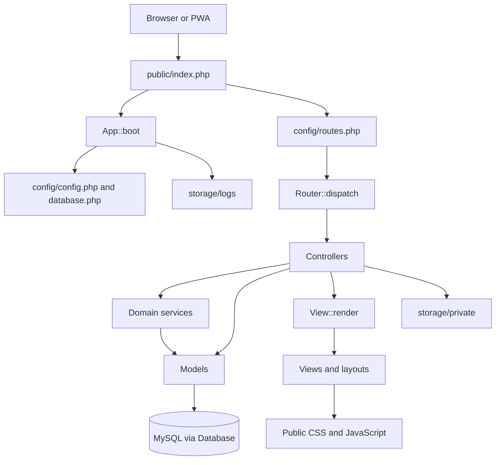
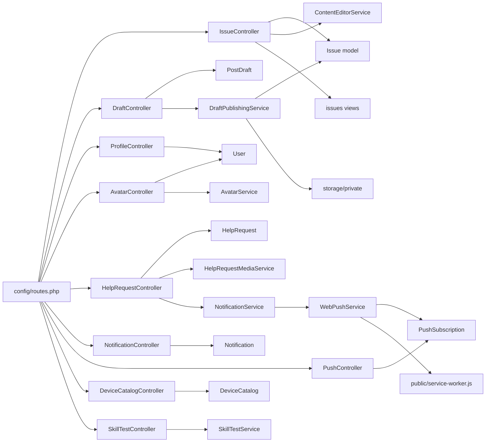
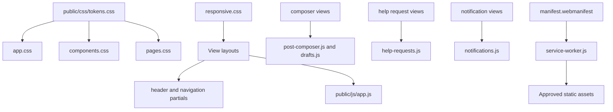

# Curated Code Relationship Graph

This is a human-reviewed, source-derived graph, not a Graphify-generated artifact. The automated graph is produced by the Graphify workflow and must be reviewed before treating inferred edges as facts.

## Application request flow

## Verified feature relationships

## Frontend relationships

## Route-to-signature contract
- `GET /avatar/{userId}` → `AvatarController::show(int $userId)` → `Router::INTEGER_ROUTE_PARAMETERS` normalizes and casts `userId`.
- `GET /profile/{username}` → `ProfileController::show(string $username)`; it remains a string.
- `/drafts/{draftId}/media/{mediaUuid}` → DraftController methods accept string UUID parameters; they remain strings.
- Issue/help/admin IDs use `{id}` and integer controller parameters.

## Maintenance rules
Add source paths and line references to high-value new edges. Mark uncertain relations Unverified. Keep this curated diagram smaller than Graphify's full symbol-level output. Review generated graph JSON/HTML for false edges, missing modules, noisy dependencies and private-path leakage before relying on it.
