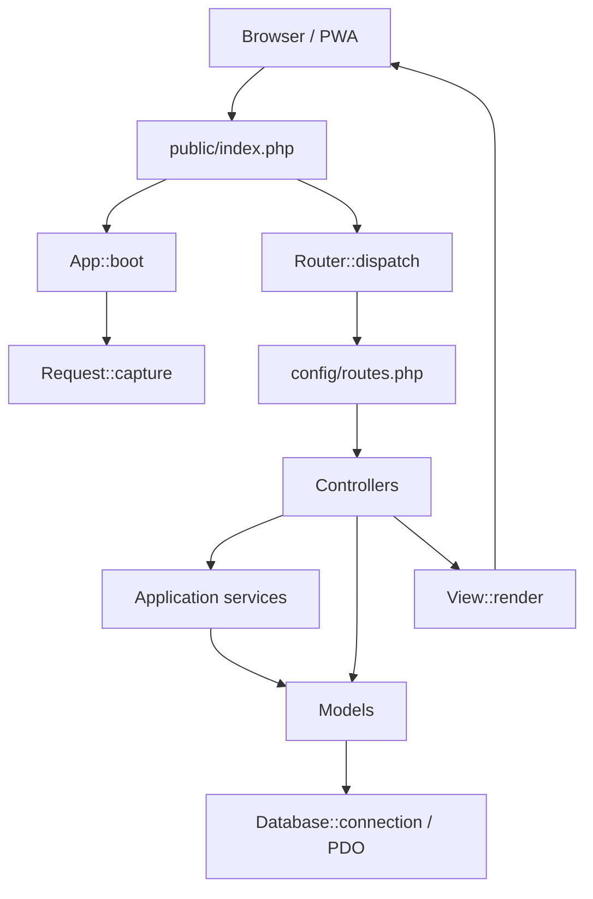
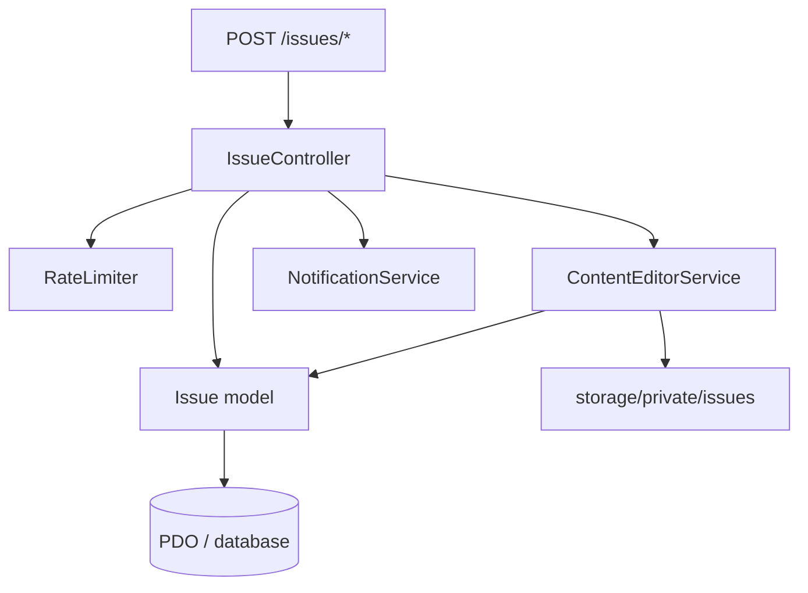
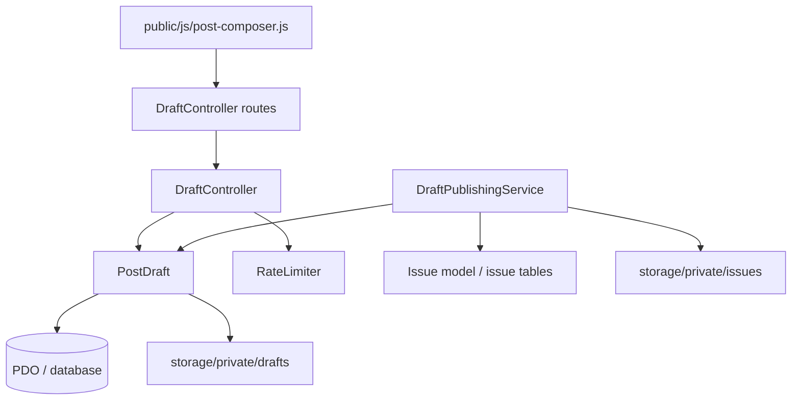
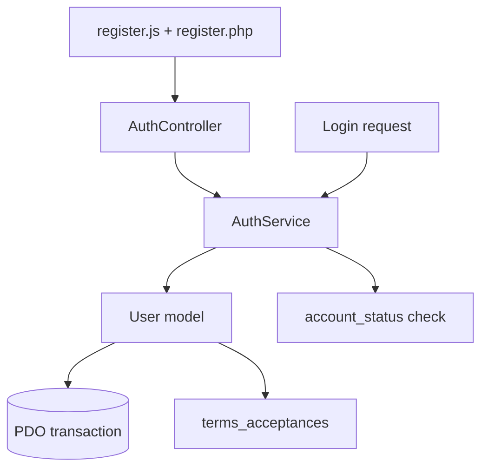
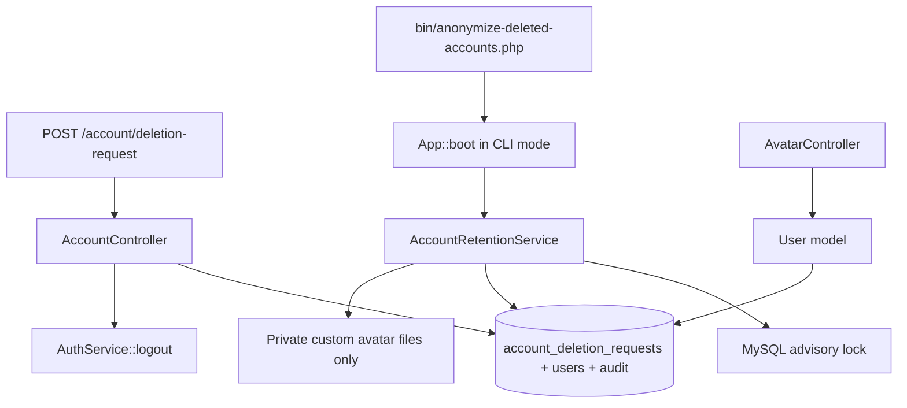

# Architecture and dependency map

This document is a source-derived map of the current PHP application. It records the concrete route, controller, service, model, database, and view relationships used in this repository. It is intended to make later reviews traceable; update it whenever a route or major service dependency changes.

> Review method: static source inspection of `public/index.php`, `config/routes.php`, and the referenced PHP classes. This is not a runtime trace, generated Graphify database, or proof that every branch has been exercised.

## Application request path

- `public/index.php` loads Composer autoloading (or its PSR-4 fallback), boots the application, registers `config/routes.php`, captures the request, and dispatches it.
- `App::boot()` loads environment/configuration, installs error and shutdown logging, prunes expired application log files, and starts a browser session only for non-CLI requests.
- `Router` applies the guest-route policy declared with each public route before invoking controllers, resolves route parameters, and returns a `Response`.
- `getPublic()` and `postPublic()` must be used only for intentionally public endpoints. The current public surface includes home, login, registration, help/policies, member profiles, public avatars, and consent-approved help-library entries. Personal inboxes, drafts, issue discussions, attachments, account actions, and administration remain authenticated.
- `Controller` is the shared base for rendering views, internal redirects, 404 responses, and flash messages.
- `Model` delegates database access to `Database::connection()`; models use PDO prepared statements and transactions where a multi-step write must be atomic.

## Generated Graphify graph

The repeatable source scanner is maintained in `tools/graphify/graphify.py`. It generates the full machine-readable dependency graph at `.graphify/graph.json` and a focused Mermaid view at `.graphify/architecture.mmd`. See [Graphify usage and accuracy boundaries](graphify.md). The JSON graph is the detailed output; this hand-written architecture map remains a navigational summary.

## Route-to-controller map

| Route family | Entry controller | Main downstream dependencies |
|---|---|---|
| Home, feed, workbench, my posts | `HomeController`, `FeedController`, `WorkbenchController`, `MyPostsController` | `Issue`, `User`, view templates |
| Technical issue lifecycle | `IssueController` | `Issue`, `ContentEditorService`, `RateLimiter`, `NotificationService`, `DraftPublishingService` |
| Draft composer and media | `DraftController` | `PostDraft`, `RateLimiter`, private file storage |
| Device catalog and suggestions | `DeviceCatalogController` | `DeviceCatalog`, `RateLimiter`, admin authorization |
| Login, registration, logout | `AuthController` | `AuthService`, `User`, `PhoneNumber` |
| Profile and avatar | `ProfileController`, `AvatarController` | `User`, `AvatarService`, private file storage |
| Personal help and public help library | `HelpRequestController` | `HelpRequest`, `HelpRequestMediaService`, `NotificationService`, `RateLimiter` |
| Notifications and Web Push | `NotificationController`, `PushController` | `Notification`, `PushSubscription`, `NotificationService`, `WebPushService` |
| Skill assessments | `SkillTestController`, `AdminSkillTestController` | `SkillTestService`, `User` |
| Administration | `AdminUserController`, `AdminFeaturedPostsController`, `AdminUpdateController` | user, featured-content, and update models/services |
| Static help, policies, settings | `PageController` | `User`, views |

The authoritative route declarations and guest exposure are both in `config/routes.php`: public routes use `getPublic()` or `postPublic()`; every route registered with `get()` or `post()` is private to authenticated members. This keeps the guest allowlist synchronized with the route table.

The browser-to-route dependency map is maintained in [JavaScript API route map](javascript-api-route-map.md). It manually resolves dynamic URLs built from `data-*` attributes, draft IDs, media UUIDs, and HTML form actions that Graphify cannot always resolve statically.

## Core feature dependency flows

### Technical post and discussion lifecycle

- New posts and discussion actions enter through `IssueController`.
- Attachments are validated and stored by `ContentEditorService`; inline tokens are resolved to persisted attachment IDs before rendering.
- `Issue` owns issue, reply, diagnostic update, repair-result, vote, and edit-history persistence.
- Notifications are emitted through `NotificationService` after successful domain actions.
- Issue attachments are served through bounded-memory streaming in `Response::streamFile()`, after path-containment and MIME validation.

### Draft composer and publishing

- The browser composer stores local/offline work and synchronizes server changes with a revision value.
- `PostDraft` locks the draft row and checks the expected revision for server-side media mutations.
- `DraftController` validates ownership, CSRF, type, MIME, size, dimensions, count limits, and revision before accepting media.
- `DraftPublishingService` transfers draft media into permanent issue storage and creates the corresponding issue/attachment records in a database transaction. Its filesystem rename operations are compensated on failure.
- Draft files may be deleted when the user explicitly deletes a draft or removes a draft attachment. This is distinct from account anonymization: the retention worker must not remove draft rows or technical files.

### Registration and authentication

- `AuthService::register()` validates contact, credentials, specialization, and explicit terms acceptance.
- `User::create()` creates the user, technician profile, device specializations, and accepted-terms record in one transaction.
- `AuthService::user()` reloads the account from the database and rejects every non-active status; credential login also rejects non-active accounts.

### Rate limiting and streamed files

- `RateLimiter::allowForUser()` is called by selected write/upload controller actions. It atomically locks account and hashed-IP buckets in `rate_limit_buckets`, created by migration 014.
- The bucket cleanup deletes only expired rate-limit metadata; it does not touch posts, user content, or uploads.
- `Response::streamFile()` handles bounded-memory file output. Controllers must perform authorization, real-path containment, and MIME checks before creating a stream response.

### Account deletion request and 30-day anonymization

- The request controller sets `account_status=deletion_pending`, records a 30-day scheduled date and logs the user out.
- The CLI worker runs in dry-run mode unless `--execute` is explicit. It re-checks due requests under row locks and anonymizes the existing `users` row in place.
- The same numeric `users.id` is retained. Login is disabled, the public author name becomes `عضو محذوف`, and a generic avatar is served.
- The worker does not delete database rows and does not traverse technical content directories. It only removes generated private custom-avatar image files. Public help-library author snapshots are anonymized while their technical article fields remain unchanged.
- Migration `016_protect_technical_history.sql` changes 43 dependent-content and attribution foreign keys to `RESTRICT`. Migration `017_block_physical_content_delete.sql` adds `BEFORE DELETE` guards for standalone technical and audit rows too. These database rules backstop the existing soft-delete/anonymization services; they do not replace those workflows. Transient notifications and push subscriptions retain their separate cleanup lifecycle.
- No cancellation endpoint is currently exposed for pending deletion requests. Do not promise self-service cancellation until that workflow is implemented and tested.

### Technical content retention and reply tombstones

- `Issue::deleteIssue()`, `Issue::deleteReply()`, and diagnostic deletion paths update soft-delete metadata; they do not physically remove published knowledge.
- A reply whose parent is soft-deleted remains in the database with its original `parent_reply_id`. `Issue::replies()` returns a tombstone when that parent still has an active child; the view hides the deleted text while retaining its place in the discussion tree.
- Migrations 016 and 017 enforce the rule below the model layer. A direct `DELETE` against a protected technical/audit table raises a database error, including standalone posts/replies with no child rows. Migration 017 also protects skill ratings/assessment definitions, skill domains, and device manufacturer/model catalog rows. Draft deletion, vote toggles, and transient push/notification cleanup remain separate intentional lifecycles.
- `AdminRosterService` centralizes active-administrator checks; `AdminUserController` uses it under the shared administrator-roster advisory lock and target/actor row locks before role or status changes.
- CI verifies the new-install chain and delete guards with synthetic fixtures on MySQL 8.0, MariaDB 10.4.32 and MariaDB 10.11. This does not authorize applying these migrations to an already-running installation without schema comparison and backup.

## Data and storage ownership

| Concern | Code owner | Persistent location |
|---|---|---|
| Users, profiles, skills, registration consent | `User`, `AuthService`, `SkillTestService` | `users`, `technician_profiles`, related skill tables, `terms_acceptances` |
| Technical posts, replies, diagnosis, repair results, history | `Issue`, `IssueController` | `issues` and related issue tables |
| Composer drafts and staged media | `PostDraft`, `DraftController` | `post_drafts`, `post_draft_media`, `storage/private/drafts` |
| Permanent media and schematics | `ContentEditorService`, `DraftPublishingService` | `issue_attachments`, issue audio fields, `storage/private/issues` |
| Personal help and publication | `HelpRequest`, `HelpRequestMediaService` | help-request/publication tables, `storage/private/help-requests` |
| Notifications and push | `Notification`, `PushSubscription`, `WebPushService` | `notifications`, `push_subscriptions` |
| Runtime and security logs | `App` | `storage/logs/{app,access,security,audit}-YYYY-MM-DD.log` |
| Rate limits | `RateLimiter` | `rate_limit_buckets` |

## Review and test boundaries

- `php-lint.yml` verifies PHP syntax and JavaScript syntax.
- `database-migrations.yml` replays the explicit fresh-install chain on disposable MySQL 8.0, MariaDB 10.4.32 and MariaDB 10.11 databases; it verifies baseline/profile schema, representative content writes, first-admin guards, retention constraints/triggers, reply tombstones, issue review/vote authorization, and administrator-roster invariants.
- These workflows do not currently simulate browser sessions, parallel uploads from multiple devices, actual Web Push delivery, UI behavior on mobile Safari, or the 30-day retention worker against a representative anonymization fixture. Five dynamically assembled JavaScript API expressions remain unresolved by Graphify's static matcher; their call sites are manually mapped in `docs/javascript-api-route-map.md`.
- A clean migration CI run is not authorization to run migrations on a live installation. Confirm the target schema history and take a backup first.
- Treat this document as a maintained static dependency map, not as generated Graphify output or a replacement for runtime/integration tests.
